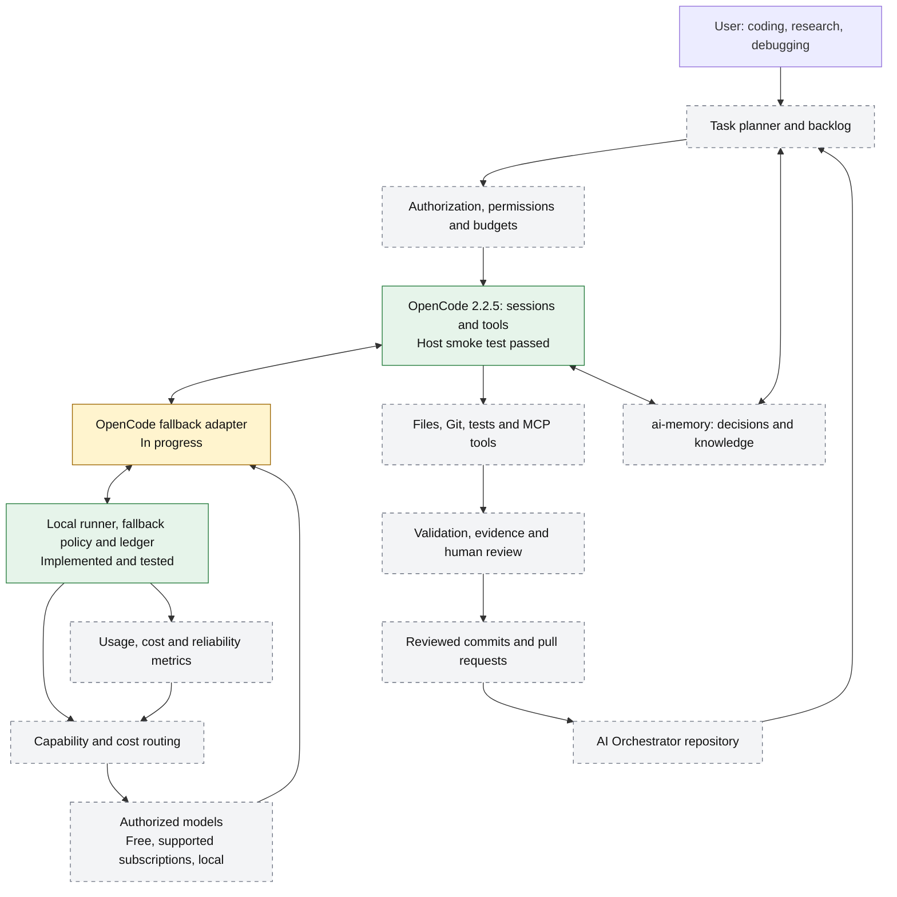

# AI Orchestrator

An incremental orchestration framework built around OpenCode. MIT licensed.

## Purpose and target architecture

The goal is to use authorized free models, supported subscriptions and local models
to code, research, investigate errors and complete tasks with controlled costs.
OpenCode supplies the execution environment; this project adds conservative fallback,
recoverable operational state and, later, persistent knowledge and task coordination.
The first practical goal is **developing this repository using the project itself**:
select a backlog task, produce a scoped change, run tests and submit evidence for
human review.

The diagram describes the **target architecture**, not an already integrated system.
Green components work locally or have passed the stated host smoke test; yellow is
in progress; dashed components are planned. The local core is not yet connected to
OpenCode through a fallback adapter.



Planned tool and review nodes describe the integrated workflow; the underlying
OpenCode tools already exist. Operational checkpoints track dispatch outcomes;
semantic memory stores knowledge and must never authorize replay. Future agents
may propose improvements, but cannot grant themselves permissions or bypass quotas.

## Current status

Implemented: pure fallback policy, HTTP/Retry-After normalization, local checkpoint
ledger, operation runner, an in-memory demo and dependency-free local tests,
including loopback HTTP transport. **This is not an installed plugin or an
integrated OpenCode MVP.** No AI calls, keys, provider accounts or paid APIs are
required for these tests.

A separate [real OpenCode smoke test](integration/README.md) uses the 2.2.5 binary
and a simulated local provider. It validates session continuity, context, explicit
model switching and denied writes. It is not the fallback adapter.

Evaluated reference: OpenCode **2.2.5**, commit
`9bbb8ce18c80f099e0e448775f59d965ead40a21`. Candidate plugins remain disabled
until they meet the [audit criteria](docs/plugin-audit.md).

## Run

Use Node.js 24 (validated with 24.22.1) from the repository root:

```sh
node --test
node examples/fallback-demo.mjs
```

No npm install is required. The demo produces two records: `mock/preferred`
returns 429 and `mock/local` returns 200 in the same session. These are in-memory
responses, not HTTP servers or real models.

## Minimal policy

- An explicit, ordered allowlist of authorized models; no catalog is enabled automatically.
- Each model is attempted at most once per operation; the default limit is two attempts.
- 429/500/502/503/504 and timeouts allow fallback only before a response and without possible effects.
- 401/403, invalid input, quotas with unknown reset times and missing metadata stop execution.
- Cooldown respects the greater of the default and normalized Retry-After in milliseconds.
- Restarting with a pending dispatch blocks automatic continuation.
- Returning to the preferred model requires a new operation after explicit completion/reconciliation.

`src/policy.mjs` makes decisions; it does not run tools, timers, HTTP or persistence.
The consumer must persist dispatch state before calling a provider. `wait` is a
decision with a timestamp, not a scheduler. The trusted caller confirms the result
using `success(state, dispatch)`; only then is `nextOperation(state)` allowed.
The old `previousCompleted: true` argument does not unlock a pending dispatch.

State version 2 assigns a UUID to each operation. Dispatches carry sessionId,
operationId and attemptId. `success` and `failure` require the original dispatch
returned by `select`, not just its model. Never reconstruct its identity from
current state when a callback arrives. Version 1 checkpoints are rejected and
require manual reconciliation; pending operations are not migrated automatically.

For persistence and exclusion between processes, use
`openSession(directory, sessionId)` from `src/ledger.mjs`. Its handle provides
`select(models, options)`, `success(dispatch)`,
`failure(dispatch, error, options)`, `nextOperation()`, `snapshot()` and `close()`.
Keep it open during the call and close it in finally. Call the provider only after
select returns action=dispatch: the checkpoint has then been written. Persistence
errors invalidate the handle. See [ADR-004](docs/adr/004-local-ledger.md).

Tests cover local checkpoints and interprocess locks, not OpenCode session recovery
or power-loss durability. The host owns message history. Use a trusted local
directory with cooperative writers; NFS/SMB and third-party-controlled directories
are unsupported. Locks left after crashes require manual reconciliation and are
never removed automatically.

## Operation runner and development plan

`runOperation` in `src/runner.mjs` combines the ledger, fallback, cancellation and
a duration budget. It accepts directory, sessionId, models, invoke, budgetMs
(default 30000), maxAttempts (default 2) and an optional signal. The invoke adapter
receives dispatch/signal and returns `{ok:true,value}` or `{ok:false,error}`.
No OpenCode adapter is installed yet. See [ADR-005](docs/adr/005-operation-runner.md):
abort does not undo effects, deadlines cannot interrupt synchronous code, and
budgets are not persisted between invocations. In-flight cancellation requires
session reconciliation.

The project has a local runner but **no integrated self-development workflow yet**.
The first real task will use an isolated branch and human review. See the
[roadmap](docs/roadmap.md) and [Definition of Done](docs/definition-of-done.md)
for status, dependencies and acceptance gates.

## Next steps

1. Validate the OpenCode adapter contract against the implemented local runner.
2. Build the OpenCode 2.2.5 adapter and end-to-end tests with failures, tools and real restarts.
3. Complete the first task in this repository using explicitly authorized models.
4. Add ai-memory integration, capability/cost routing and bounded multi-agent work incrementally.

`src/http-failure.mjs` accepts Retry-After as integer seconds or canonical
IMF-fixdate. Invalid values, overflow and obsolete formats are conservatively
rejected. This is not a complete HTTP parser. Replay safety must come from the
host; a 429 status alone does not prove absence of effects. Private bodies and
headers are not copied.

See [requirements](docs/requirements.md), [ADR-001](docs/adr/001-composition.md),
[validation](docs/validation.md) and [contributing](CONTRIBUTING.md).
