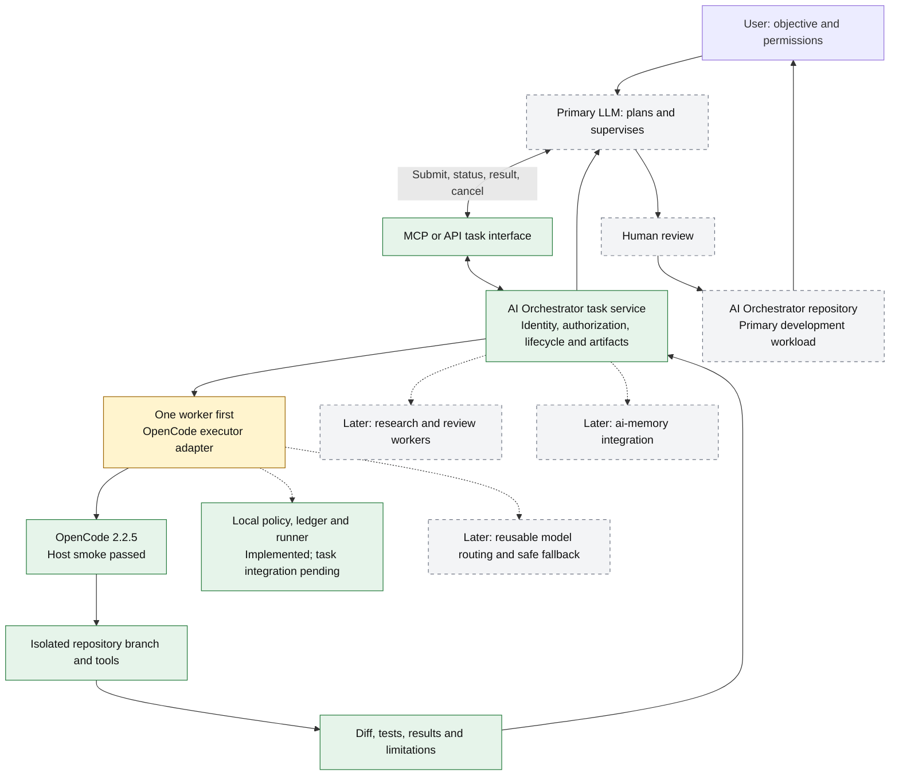

# AI Orchestrator

A pluggable worker service for a supervising LLM. MIT licensed.

## Purpose and target architecture

Connect a primary LLM in a compatible local or web client to AI Orchestrator.
The primary LLM plans, delegates tasks, checks progress and reviews results;
workers perform the execution. The service should return task status, artifacts,
diffs and test evidence while respecting authorized models, tools and budgets.

**The primary acceptance test is developing AI Orchestrator itself:** delegate a
small backlog task to one worker, retrieve its diff and test report, and review
before merging. The supervised use milestone remains pending.

OpenCode 2.2.5 is the first worker executor and selected supervising client.
MCP over stdio is the selected first transport under ADR-007.
The MCP endpoint and one-worker service are implemented. See the current gates and
limitations in the [roadmap](docs/roadmap.md) and [handoff](docs/handoff.md).

The diagram shows the **target architecture**, not a completed integration.
Green marks local implemented components or the verified host smoke; yellow marks
evaluation/integration work; dashed nodes are planned.



Tasks should continue between status queries. Continuous supervision depends on
the primary client's invocation/notification support; polling is sufficient for
the first MVP. A web client needs a compatible interface and network access;
a local service is not automatically accessible from the web.

Operational state and semantic memory remain separate. Neither task instructions
nor worker results grant permissions. The first workflow has no automatic merge.

## Current status

Implemented: pure fallback policy, HTTP/Retry-After normalization, local checkpoint
ledger, durable task store, serial service scheduler, artifacts, cancellation,
four-operation MCP stdio adapter, pinned-client acceptance harness, maintainer
recovery and opt-in diagnostics. Verified 2026-11-22: main `11fcb42` includes
B12–B19 and B29's anonymous-route **fixture preparation**. B30/#45 is a draft
relay/gateway/approval implementation with partial deployment evidence; it is
not live-provider support. B20/#43 has no real delegated project diff.
**M2b sign-off and M3 remain open.** No AI calls, keys, provider accounts or paid
APIs are required for local tests. See the
[project reassessment](docs/project-reassessment-2026-11-22.md) for what to keep,
finish and defer, including why physical FIDO2 is profile-specific.

M2a is complete as a specification: the normative [task contract](docs/task-contract.md)
and [ADR-007](docs/adr/007-task-contract.md) define the four task operations,
lifecycle, ownership, limits and artifacts, select MCP over stdio with OpenCode 2.2.5
as the first client behind a capability gate, and record the pinned reuse/build
decision. The task store (`src/tasks.mjs`) and service (`src/service.mjs`) are
implemented. B12 adds an opt-in serial scheduler (`src/scheduler.mjs`) that persists
one attempt before creating an isolated worktree and launching a configured worker.
The B11 adapter supports only a loopback fixture provider. Local process/host
evidence is recorded in [validation](docs/validation.md). B15 adds the four-operation
MCP stdio adapter (`mcp-server.mjs`), with bounded framing and sanitized protocol
errors. The pinned OpenCode 2.2.5 fixture gate discovers all four tools, submits a
task and observes its queued result in model context. B16/B17 client workflow and
acceptance work is merged (#40 at `190370f`), but this does not provide a
production provider or complete delegation MVP. B18 maintainer recovery and
retention are merged as PR #41 at `c268239`. B19 adds a manual, opt-in capability
pulse and read-only task-history track; it does not schedule work, execute tasks or
advance M2b/M3 by itself. Its implementation passed supervisor review after correction
and is delivered in [PR #42](https://github.com/pbsilvabd/ai-orchestrator/pull/42),
which records current-head checks and the merge decision.

A separate [real OpenCode smoke test](integration/README.md) uses the 2.2.5 binary
and a simulated local provider. It validates session continuity, context, explicit
model switching and denied writes. It is not the fallback adapter.

Evaluated reference: OpenCode **2.2.5**, commit
`9bbb8ce18c80f099e0e448775f59d965ead40a21`. Candidate plugins remain disabled
until they meet the [audit criteria](docs/plugin-audit.md).

## Repository maintenance skills (Codex)

The repo includes two development workflows under `.agents/skills`:

- [$orchestrator-task](.agents/skills/orchestrator-task/SKILL.md): implement one
  assigned backlog card using the existing execution/acceptance protocol.
- [$orchestrator-review](.agents/skills/orchestrator-review/SKILL.md): review a PR
  or correction at its current commit and report findings with evidence.

For example, request `$orchestrator-task Execute B13` or
`$orchestrator-review Review PR NUMBER`. Automatic selection may also use the
skill descriptions. These instructions guide repository development; the OpenCode
worker's `skills: []` configuration and service authorization remain unchanged.

## Run

Use Node.js 24 (validated with 24.22.1) from the repository root:

```sh
node --test
node examples/fallback-demo.mjs
```

No npm install is required. The demo produces two records: `mock/preferred`
returns 429 and `mock/local` returns 200 in the same session. These are in-memory
responses, not HTTP servers or real models.

## Local task maintenance

The maintainer-only CLI supports inspection, explicit blocked-task reconciliation and
30-day pruning. It is excluded from the service and MCP tools. Stop workers, back up
the state home, and follow the Windows-specific stale-owner/process-tree procedure
before recovery: [task maintenance](docs/task-maintenance.md). PID absence alone does
not prove descendants stopped or effects reverted; ambiguity must remain blocked.

The local MCP task server starts with `node mcp-server.mjs`. Set
`AI_ORCHESTRATOR_HOME` to a trusted state directory and point
`AI_ORCHESTRATOR_CONFIG` to a JSON file containing the client identity, model/tool
allowlists, writable roots and limits. The server writes only protocol messages to
stdout; startup and shutdown diagnostics go to stderr.

## Minimal policy

- An explicit, ordered allowlist of authorized models; no catalog is enabled automatically.
- Each model is attempted at most once per operation; the default limit is two attempts.
- 429/500/502/503/504 and timeouts allow fallback only before a response and without possible effects.
- 401/403, invalid input, quotas with unknown reset times and missing metadata stop execution.
- Cooldown respects the greater of the default and normalized Retry-After in milliseconds.
- Restarting with a pending dispatch blocks automatic continuation.
- Returning to the preferred model requires a new operation after explicit completion/reconciliation.

`src/policy.mjs` makes decisions; it does not run tools, timers, HTTP or persistence.
The consumer must persist dispatch state before calling a provider. `wait` is a
decision with a timestamp, not a scheduler. The trusted caller confirms the result
using `success(state, dispatch)`; only then is `nextOperation(state)` allowed.
The old `previousCompleted: true` argument does not unlock a pending dispatch.

State version 2 assigns a UUID to each operation. Dispatches carry sessionId,
operationId and attemptId. `success` and `failure` require the original dispatch
returned by `select`, not just its model. Never reconstruct its identity from
current state when a callback arrives. Version 1 checkpoints are rejected and
require manual reconciliation; pending operations are not migrated automatically.

For persistence and exclusion between processes, use
`openSession(directory, sessionId)` from `src/ledger.mjs`. Its handle provides
`select(models, options)`, `success(dispatch)`,
`failure(dispatch, error, options)`, `nextOperation()`, `snapshot()` and `close()`.
Keep it open during the call and close it in finally. Call the provider only after
select returns action=dispatch: the checkpoint has then been written. Persistence
errors invalidate the handle. See [ADR-004](docs/adr/004-local-ledger.md).

Tests cover local checkpoints and interprocess locks, not OpenCode session recovery
or power-loss durability. The host owns message history. Use a trusted local
directory with cooperative writers; NFS/SMB and third-party-controlled directories
are unsupported. Locks left after crashes require manual reconciliation and are
never removed automatically.

## Operation runner and development plan

`runOperation` in `src/runner.mjs` combines the ledger, fallback, cancellation and
a duration budget. It accepts directory, sessionId, models, invoke, budgetMs
(default 30000), maxAttempts (default 2) and an optional signal. The invoke adapter
receives dispatch/signal and returns `{ok:true,value}` or `{ok:false,error}`.
No OpenCode adapter is installed yet. See [ADR-005](docs/adr/005-operation-runner.md):
abort does not undo effects, deadlines cannot interrupt synchronous code, and
budgets are not persisted between invocations. In-flight cancellation requires
session reconciliation.

The project has a local runner but **no integrated self-development workflow yet**.
The first real task will use an isolated branch and human review. See the
[roadmap](docs/roadmap.md) and [Definition of Done](docs/definition-of-done.md)
for status, dependencies and acceptance gates.

## Next steps

1. Resolve approval-profile [#47](https://github.com/pbsilvabd/ai-orchestrator/issues/47)
   and compartment-aware composition [#46](https://github.com/pbsilvabd/ai-orchestrator/issues/46)
   before another B30 deployment campaign. Current FIDO2/egress gates stay in force.
2. Stabilize test readiness [#48](https://github.com/pbsilvabd/ai-orchestrator/issues/48),
   collect actual end-to-end deployment evidence, and review the final B30 head.
3. Reconcile M2b acceptance, obtain exact provider/model/objective/budget approval,
   then continue B20/#43. Fallback, SQLite, memory and routing are not prerequisites
   for first supervised use.

`src/http-failure.mjs` accepts Retry-After as integer seconds or canonical
IMF-fixdate. Invalid values, overflow and obsolete formats are conservatively
rejected. This is not a complete HTTP parser. Replay safety must come from the
host; a 429 status alone does not prove absence of effects. Private bodies and
headers are not copied.

See [requirements](docs/requirements.md), [task contract](docs/task-contract.md),
[ADR-001](docs/adr/001-composition.md), [validation](docs/validation.md) and
[contributing](CONTRIBUTING.md).
